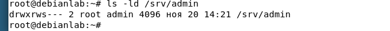
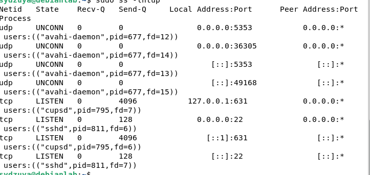
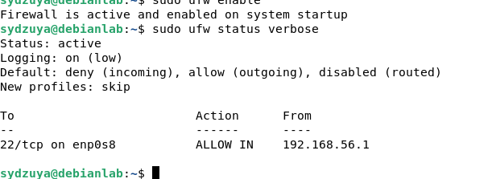

# debian-server-setup

Учебный стенд для администрирования Debian в VirtualBox. Я подключился к ВМ по SSH из Windows, проверил выход Debian в интернет и настроил доступ к общему каталогу через группу Linux.

При повторении стенда замените `labuser` на имя своей учётной записи Debian в командах и в копии конфигурации SSH.

## Окружение

| Параметр | На стенде |
| --- | --- |
| Хост | Windows 11 |
| Виртуализация | Oracle VirtualBox |
| Гостевая ОС | Debian 13.7 (Trixie) |
| Ресурсы ВМ | 2 vCPU, 5 961 МБ ОЗУ, динамический VDI на 40 ГиБ |

## Сеть VirtualBox

| Адаптер | Интерфейс Debian | IPv4 Debian | Назначение |
| --- | --- | --- | --- |
| 1, NAT | `enp0s3` | `10.0.2.15/24` | Выход в интернет через шлюз `10.0.2.2` |
| 2, Host-only | `enp0s8` | `192.168.56.101/24` | Подключение по SSH из Windows с адреса `192.168.56.1` |

Адреса и имена интерфейсов в командах относятся к этому стенду.

## Диагностика NAT

После подключения второго адаптера SSH по Host-only работал. Команда `ip -4 route` показывала только маршрут к `192.168.56.0/24`. В `nmcli device status` интерфейс `enp0s3` был отключён в NetworkManager, а список профилей показывал активное проводное подключение только на `enp0s8`.

Создал для `enp0s3` отдельный профиль с получением IPv4 по DHCP.

```bash
nmcli connection add type ethernet ifname enp0s3 con-name 'VirtualBox NAT' ipv4.method auto
```

После активации профиля `ip -4 route` показала `default via 10.0.2.2 dev enp0s3` и адрес `10.0.2.15` в этом маршруте. Затем проверил HTTPS-запрос к репозиторию пакетов из ВМ.

```bash
wget -4 --spider -T 10 -t 1 https://deb.debian.org/debian/dists/trixie/InRelease
```

Сервер вернул `200 OK`. Из Windows также проверил доступность порта `192.168.56.101:22` после настройки NAT.


## Пользователи, группы и права

Для примера создал группу `admin` и выделил ей общий каталог `/srv/admin`. Команды настройки выполняются под `root`.

```bash
groupadd admin
usermod -aG admin labuser
install -d -o root -g admin -m 2770 /srv/admin
```

Вывод `ls -ld /srv/admin` подтвердил `root:admin` и `drwxrws---`. Права `770` дают владельцу и группе доступ к каталогу. Начальная `2` устанавливает бит `setgid`, поэтому группа `admin` наследуется при создании файлов и подкаталогов.

Проверка от имени участника группы и от имени системной учётной записи `nobody`.

```bash
runuser -u labuser -- touch /srv/admin/access-test.txt
runuser -u nobody -- ls /srv/admin
```

Участник группы создал файл, который получил группу `admin`. При попытке прочитать каталог от имени `nobody` команда `ls` вернула «Отказано в доступе».



### Права `sudo` через `visudo`

Для существующей учётной записи Debian я настроил право выполнять административные команды через `sudo`. Для изменения правил `sudoers` использовал `visudo`. Он проверяет синтаксис при сохранении.

При первом назначении прав откройте редактор из оболочки `root`.

```bash
visudo
```

Пример правила, которое даёт пользователю `labuser` право запускать любые команды через `sudo`.

```sudoers
labuser ALL=(ALL:ALL) ALL
```

Из учётной записи с действующим `sudo` редактор открывается командой `sudo visudo`. После сохранения проверьте доступ из обычного сеанса пользователя.

```bash
sudo whoami
```

Ожидаемый вывод — `root`.

## SSH из Windows

В Debian проверил службу OpenSSH и отпечаток открытого ключа сервера.

```bash
systemctl status ssh --no-pager
ssh-keygen -lf /etc/ssh/ssh_host_ed25519_key.pub
```

Служба `ssh` была запущена (`active (running)`), её запуск при загрузке включён (`enabled`). В Windows подключился по Host-only.

```powershell
ssh labuser@192.168.56.101
```

Вход с паролем прошёл. Отпечаток ED25519 из окна Windows совпал с отпечатком ключа в консоли ВМ.

### Межсетевой экран UFW

В консоли VirtualBox установил UFW.

```bash
sudo apt install ufw
```

Перед добавлением правила проверил слушающие сокеты командой `sudo ss -lntup`. Процесс `sshd` слушал `22/tcp` на IPv4 и IPv6.



Добавил правило для подключения из Windows перед включением фильтра.

```bash
sudo ufw allow in on enp0s8 proto tcp from 192.168.56.1 to any port 22
sudo ufw enable
sudo ufw status verbose
```

UFW показал `Status: active`, запрет входящих и разрешение исходящих соединений по умолчанию. Правило `22/tcp on enp0s8` разрешает входящий SSH с IPv4-адреса Windows `192.168.56.1` через Host-only.



После включения UFW я открыл новый SSH-сеанс из Windows и успешно вошёл в Debian.

## Клавиши в терминале Debian

В Bash набери начало команды или пути и нажми `Tab`. Например, `systemct` + `Tab` дополнит команду до `systemctl`. Если совпадений несколько, нажми `Tab` ещё раз, чтобы увидеть варианты.

| Программа | Сохранение и выход |
| --- | --- |
| Nano | `Ctrl+O`, затем `Enter` сохраняют файл. `Ctrl+X` закрывает редактор. |
| Vim | `Esc`, затем `:wq` и `Enter` сохраняют файл и закрывают редактор. |
| `less` | `q` закрывает просмотр. |

Клавиши в `sudo visudo` зависят от открывшегося редактора. В Nano подсказка `^X` означает `Ctrl+X`.

## Примеры конфигурации

- Профиль NetworkManager для `enp0s3` с автоматическим подключением и IPv4 по DHCP. [Файл профиля NAT](configs/virtualbox-nat.nmconnection.example), [справка NetworkManager для Debian](https://manpages.debian.org/trixie/network-manager/nm-settings-keyfile.5.en.html).
- Конфигурация SSH-клиента для подключения через Host-only. Запустите `ssh -F configs/ssh-client.conf debianlab` из корня репозитория. [Файл конфигурации SSH](configs/ssh-client.conf).
